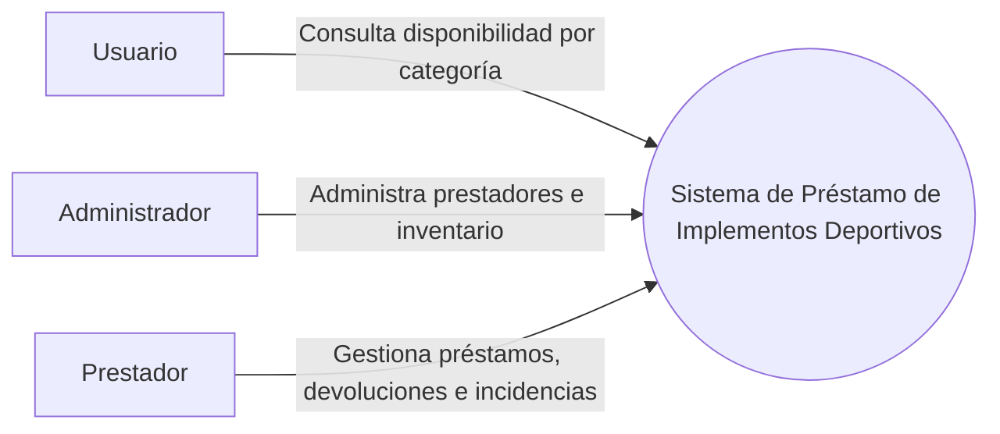
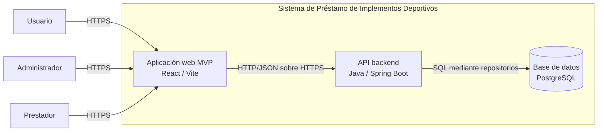
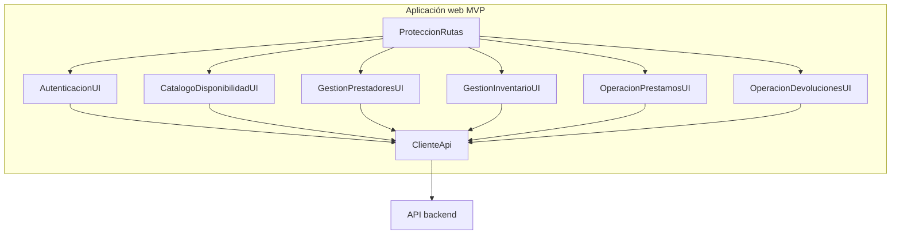
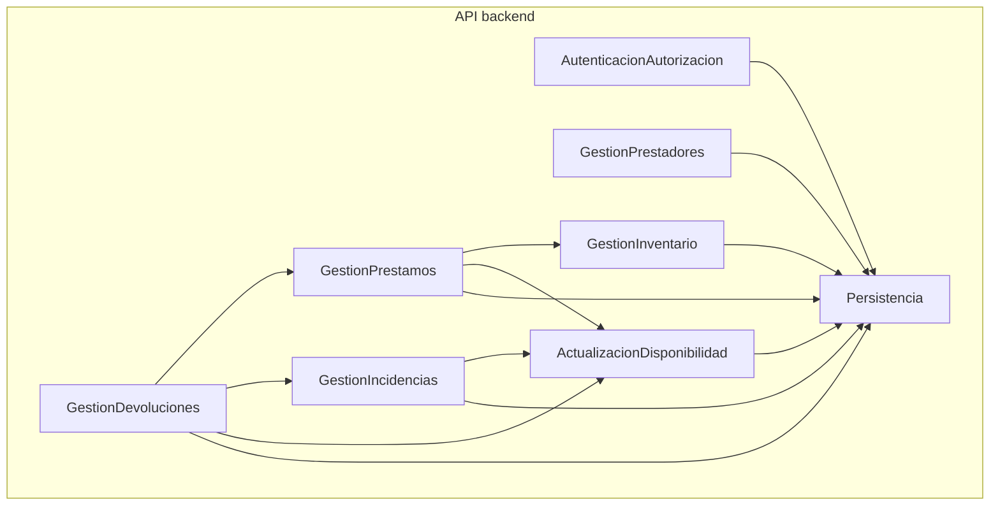
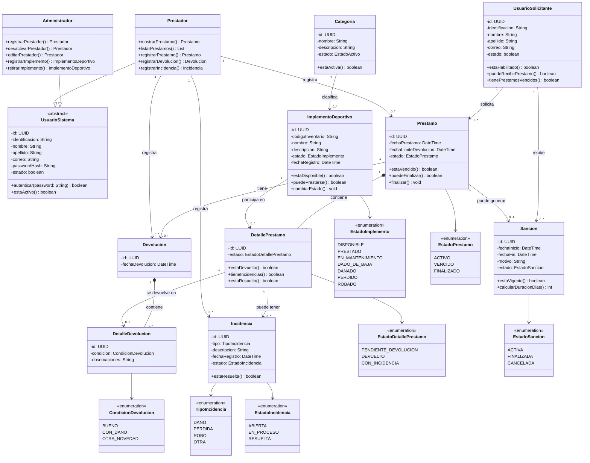
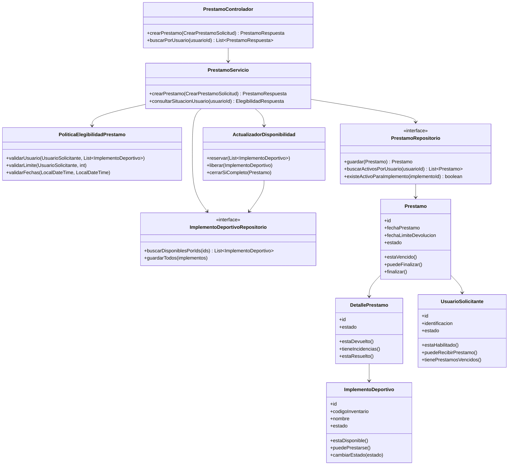
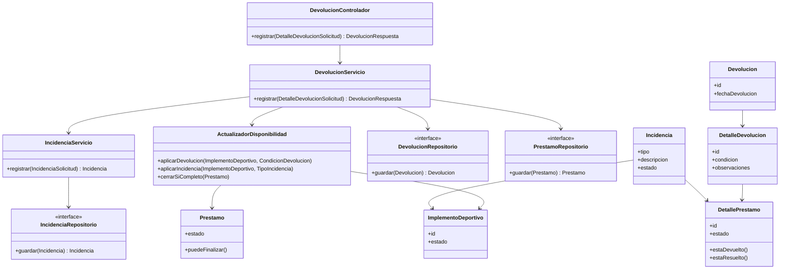

# Laboratorio - Modelo C4 para el Sistema de Préstamo de Implementos Deportivos

## Integrantes

- Cristian Rojas Betancur
- Diego Alexander Ardila Sanchez
- Mariana Duque Grajales
- Santiago Cortes Zuluaga

## 1. Comprensión del problema

### 1.1 Sistema que se está modelando

El sistema modelado es el **Sistema de Préstamo de Implementos Deportivos**, una
plataforma web para consultar el inventario y gestionar el ciclo de vida de los
préstamos dentro de una institución académica o complejo deportivo.

El alcance corresponde al MVP definido en el contexto del proyecto. Incluye
autenticación, control de acceso por rol, administración de prestadores,
administración de inventario, consulta de disponibilidad, registro y consulta de
préstamos, devoluciones e incidencias.

### 1.2 Problema actual

El proceso actual se realiza principalmente de forma manual en el almacén
deportivo. El usuario solicita verbalmente un implemento, el personal busca la
información en registros físicos y se diligencian datos en formatos manuales. La
devolución se registra de manera similar, sin una verificación consistente del
estado físico del implemento.

Las principales causas son:

- No existe un canal digital para consultar previamente la disponibilidad por
  categoría.
- No hay control automatizado de fechas límite, préstamos vencidos y sanciones.
- La información del inventario, los préstamos y las devoluciones no se mantiene
  sincronizada en tiempo real.
- La verificación de daños, pérdidas o robos depende de registros manuales.

Los impactos son demoras en la atención, desconocimiento de la disponibilidad,
pérdida de trazabilidad, deterioro o pérdida de material deportivo y mayores
costos de reposición y mantenimiento.

### 1.3 Actores principales

| Actor | Responsabilidad e interacción |
|---|---|
| Usuario | Consulta la disponibilidad de implementos por categoría y puede solicitar implementos a través del proceso atendido por un prestador. |
| Administrador | Inicia sesión, registra y consulta prestadores, actualiza o desactiva prestadores, y administra el inventario. |
| Prestador | Consulta la situación del usuario, registra préstamos, consulta préstamos, registra devoluciones e incidencias y verifica el estado de los implementos. |

### 1.4 Responsabilidad y límite de la plataforma

La plataforma automatiza y da trazabilidad al ciclo de vida del préstamo:
autenticación, autorización, inventario, disponibilidad, préstamo, devolución e
incidencias. También conserva el historial de las operaciones y aplica las reglas
de negocio antes de modificar el inventario.

La responsabilidad termina en la gestión digital de la información y las
operaciones del servicio de préstamo. La institución conserva la responsabilidad
de sus políticas, del inventario físico y de la operación presencial del almacén.

No se modelan ERP, mapas, geolocalización, notificaciones externas ni otros
sistemas de terceros porque no hacen parte del contexto del MVP proporcionado.

### 1.5 Información administrada

- Usuarios y roles.
- Prestadores habilitados o deshabilitados.
- Implementos, unidades físicas, categorías, estados y disponibilidad.
- Préstamos, fechas, responsables y usuarios solicitantes.
- Devoluciones, condiciones de recepción y fechas.
- Incidencias por daño, pérdida, robo u otra novedad.
- Sanciones derivadas de entregas tardías.

### 1.6 Principales interacciones

1. El usuario consulta los implementos disponibles y filtra por categoría.
2. El administrador mantiene los prestadores y el inventario.
3. El prestador verifica la elegibilidad del usuario y la disponibilidad de las
   unidades físicas antes de registrar un préstamo.
4. La plataforma actualiza la disponibilidad de manera consistente al prestar,
   devolver o reportar una incidencia.
5. El prestador registra la condición de cada implemento devuelto y consulta el
   historial de devoluciones.

### 1.7 Requisitos y reglas que guían el modelo

Los requisitos de usuario se agrupan en cuatro épicas: gestión de usuarios y
acceso (HU-01 a HU-04), gestión de implementos y disponibilidad (HU-05 a
HU-08), gestión de préstamos (HU-09 a HU-12) y gestión de devoluciones e
incidencias (HU-13 a HU-16).

| Grupo | Requisitos relevantes |
|---|---|
| Acceso y prestadores | RF-01 a RF-06, RNF-02 a RNF-06 |
| Inventario y disponibilidad | RF-07 a RF-10, RN-04, RNF-01, RNF-03 |
| Préstamos | RF-11 a RF-14, RN-01 a RN-05, RNF-01, RNF-03, RNF-05 |
| Devoluciones e incidencias | RF-15 a RF-19, RN-03, RN-06, RN-07, RNF-01, RNF-03, RNF-05 |

#### Reglas de negocio críticas

| ID | Regla |
|---|---|
| RN-01 | Un usuario puede tener como máximo cuatro implementos en préstamo. |
| RN-02 | Un préstamo regular dura como máximo 24 horas desde la entrega. |
| RN-03 | Una entrega tardía sin justificación genera una suspensión equivalente al doble del retraso, con mínimo de dos días. |
| RN-04 | Los implementos en mantenimiento o dados de baja no pueden reservarse ni prestarse. |
| RN-05 | Un usuario habilitado no puede recibir implementos si tiene préstamos vencidos pendientes. |
| RN-06 | Una unidad física no puede pertenecer simultáneamente a dos préstamos activos. |
| RN-07 | El préstamo finaliza cuando todos sus implementos fueron devueltos o resueltos mediante una incidencia. |

## 2. C4 Nivel 1 - Contexto

El nivel de contexto representa el sistema como una caja negra. Los actores están
fuera del límite del sistema y solamente se muestran sus interacciones con la
plataforma. No se incluyen base de datos, API, componentes, clases ni frameworks.



### 2.1 Relaciones del contexto

| Relación | Propósito |
|---|---|
| Usuario → Sistema | Consultar la disponibilidad actual de implementos y categorías. |
| Administrador → Sistema | Registrar, consultar, actualizar y desactivar prestadores; registrar, consultar, actualizar y retirar implementos. |
| Prestador → Sistema | Validar usuarios, registrar y consultar préstamos, registrar devoluciones e incidencias y actualizar la disponibilidad. |

El sistema aparece como un único software system porque en este nivel interesa
definir el límite de responsabilidad y sus usuarios, no su estructura interna.
La base de datos, la API, las pantallas, las clases y React/Spring Boot se
introducen en niveles posteriores, donde aportan información arquitectónica útil.

## 3. C4 Nivel 2 - Contenedores

Un contenedor es una unidad ejecutable o un almacén de datos con una
responsabilidad arquitectónica propia. Para el MVP se definen tres contenedores:
una aplicación web, una API backend y una base de datos. No se crean contenedores
separados para notificaciones, mapas, geolocalización o ERP porque fueron
excluidos explícitamente del alcance.

### 3.1 Contenedores definidos

| Contenedor | Responsabilidad | Tecnología propuesta | Comunicación |
|---|---|---|---|
| Aplicación web MVP | Presentar las funcionalidades según el rol, capturar datos, mostrar resultados y manejar el estado de sesión. | React con Vite | HTTPS y JSON hacia la API backend. |
| API backend | Autenticar, autorizar, validar reglas de negocio, coordinar préstamos/devoluciones y exponer operaciones del MVP. | Java con Spring Boot | HTTP/JSON sobre HTTPS; acceso a PostgreSQL mediante persistencia interna. |
| Base de datos | Persistir usuarios, prestadores, inventario, préstamos, devoluciones e incidencias con integridad transaccional. | PostgreSQL | Conexión privada desde la API backend mediante el controlador/repositorio de datos. |

### 3.2 Diagrama de contenedores



### 3.3 Decisiones y límites

- La aplicación web no accede directamente a PostgreSQL; todo acceso pasa por
  la API.
- La API concentra autenticación, autorización, validaciones y reglas de
  negocio para evitar duplicarlas entre pantallas.
- La base de datos es un almacén de datos, no un componente de interfaz ni una
  clase de dominio.
- El protocolo HTTP/JSON permite separar la presentación del backend y mantener
  una interfaz explícita entre ambos contenedores.
- La consistencia de préstamos, devoluciones, incidencias y disponibilidad se
  garantiza en la API y mediante transacciones de PostgreSQL.

### 3.4 Relación con requisitos no funcionales

| Requisito | Decisión en contenedores |
|---|---|
| RNF-01 Rendimiento | La API ofrece consultas y filtros acotados; PostgreSQL soporta índices y consultas eficientes para la concurrencia estimada. |
| RNF-02 Disponibilidad | La aplicación web, la API y PostgreSQL son unidades separadas, lo que permite operar y mantener cada responsabilidad de forma controlada. |
| RNF-03 Seguridad | La API es el punto obligatorio de autenticación y autorización; la web no decide por sí sola el acceso. |
| RNF-04 Usabilidad | La aplicación web presenta mensajes de confirmación y error adecuados al rol. |
| RNF-05 Integridad | La API coordina operaciones transaccionales y PostgreSQL persiste cambios consistentes. |
| RNF-06 Compatibilidad | La aplicación web responsive soporta escritorio y pantallas desde 360 px. |

### 3.5 Criterio para separar contenedores

Cada elemento se separa cuando tiene un ciclo de ejecución, una responsabilidad,
una tecnología o un límite de comunicación distinto. La aplicación web, la API y
PostgreSQL pueden desplegarse y evolucionar con responsabilidades diferentes;
por eso son contenedores independientes. Las reglas de negocio, repositorios y
pantallas internas todavía no son contenedores: pertenecen al nivel de
componentes o código.

## 4. C4 Nivel 3 - Componentes

Los componentes representan responsabilidades significativas dentro de la
aplicación web o de la API. No representan entidades aisladas como Usuario,
Implemento o Préstamo; esas entidades aparecerán como elementos de código cuando
sean necesarias para materializar una responsabilidad.

### 4.1 Componentes de la aplicación web MVP

| Componente | Responsabilidad | Dependencias principales | HUs/RF relacionados |
|---|---|---|---|
| AutenticacionUI | Inicio y cierre de sesión, manejo del estado autenticado y mensajes de acceso. | ClienteApi, Protección de rutas | HU-01, RF-01, RF-02 |
| CatalogoDisponibilidadUI | Consulta y filtrado de implementos disponibles por categoría. | ClienteApi | HU-08, RF-10 |
| GestionPrestadoresUI | Registro, consulta, actualización y desactivación de prestadores. | ClienteApi, Protección de rutas | HU-02 a HU-04, RF-03 a RF-06 |
| GestionInventarioUI | Registro, consulta, actualización y retiro de implementos. | ClienteApi, Protección de rutas | HU-05 a HU-07, RF-07 a RF-09 |
| OperacionPrestamosUI | Consulta del usuario, validación previa y registro del préstamo. | ClienteApi, Protección de rutas | HU-09 a HU-12, RF-11 a RF-13 |
| OperacionDevolucionesUI | Registro de devoluciones, condiciones e incidencias y consulta de historial. | ClienteApi, Protección de rutas | HU-13 a HU-16, RF-15 a RF-19 |
| ClienteApi | Comunicación HTTP centralizada, serialización y tratamiento común de respuestas y errores. | API backend | Todos los flujos web |
| ProteccionRutas | Impide navegación a vistas no autorizadas según la sesión y el rol. | Estado de autenticación | RF-02, RNF-03 |



### 4.2 Componentes de la API backend

| Componente | Responsabilidad | Dependencias principales | HUs/RF/RN relacionados |
|---|---|---|---|
| AutenticacionAutorizacion | Autenticar credenciales y autorizar operaciones según el rol. | Persistencia, Usuario, seguridad de Spring | HU-01, RF-01, RF-02, RNF-03 |
| GestionPrestadores | Crear, consultar, filtrar, actualizar y desactivar prestadores. | Persistencia, autorización | HU-02 a HU-04, RF-03 a RF-06 |
| GestionInventario | Administrar categorías, unidades físicas, estados y datos del inventario. | Persistencia, autorización | HU-05 a HU-08, RF-07 a RF-10, RN-04 |
| GestionPrestamos | Evaluar elegibilidad, límite, fechas y exclusividad; registrar y consultar préstamos. | GestionInventario, Persistencia, ActualizacionDisponibilidad | HU-09 a HU-12, RF-11 a RF-14, RN-01 a RN-05 |
| GestionDevoluciones | Registrar devoluciones parciales o totales, fechas y condiciones de recepción. | GestionPrestamos, GestionIncidencias, ActualizacionDisponibilidad | HU-13, HU-14, RF-15, RF-16 |
| GestionIncidencias | Registrar daños, pérdidas, robos y otras novedades asociadas al préstamo y al implemento. | Persistencia, ActualizacionDisponibilidad | HU-15, HU-16, RF-17, RN-06, RN-07 |
| ActualizacionDisponibilidad | Sincronizar el estado de cada unidad física y cerrar el préstamo cuando corresponda. | Persistencia, reglas de préstamo | HU-12, HU-16, RF-13, RF-18, RN-04, RN-06, RN-07 |
| Persistencia | Abstraer el acceso transaccional a PostgreSQL mediante repositorios. | PostgreSQL | Todos los flujos que persisten información |



### 4.3 Trazabilidad de requisitos a componentes

| Requisitos | Componentes responsables |
|---|---|
| RF-01, RF-02 | AutenticacionUI, ProteccionRutas, AutenticacionAutorizacion |
| RF-03 a RF-06 | GestionPrestadoresUI, GestionPrestadores |
| RF-07 a RF-09 | GestionInventarioUI, GestionInventario |
| RF-10 | CatalogoDisponibilidadUI, GestionInventario |
| RF-11, RF-12, RF-14 | OperacionPrestamosUI, GestionPrestamos |
| RF-13, RF-18 | GestionPrestamos, GestionDevoluciones, GestionIncidencias, ActualizacionDisponibilidad |
| RF-15, RF-16 | OperacionDevolucionesUI, GestionDevoluciones |
| RF-17 | OperacionDevolucionesUI, GestionIncidencias |
| RF-19 | OperacionDevolucionesUI, GestionDevoluciones |
| RN-01, RN-02, RN-03, RN-05 | GestionPrestamos |
| RN-04 | GestionInventario, GestionPrestamos, ActualizacionDisponibilidad |
| RN-06, RN-07 | GestionDevoluciones, GestionIncidencias, ActualizacionDisponibilidad |
| RNF-01 a RNF-06 | ClienteApi, ProteccionRutas, AutenticacionAutorizacion, Persistencia y componentes de cada flujo |

### 4.4 Justificación arquitectónica

- Las interfaces web se separan por flujo funcional y rol para mantener vistas
  comprensibles y evitar que una pantalla concentre todo el MVP.
- `ClienteApi` centraliza la comunicación y evita que cada vista implemente su
  propio manejo de autenticación, errores y serialización.
- La API separa gestión de préstamos, devoluciones e incidencias porque cada
  proceso tiene reglas distintas, aunque comparten `ActualizacionDisponibilidad`.
- `ActualizacionDisponibilidad` es un componente transversal porque la misma
  consistencia debe conservarse al prestar, devolver o reportar una incidencia.
- `Persistencia` encapsula el acceso a PostgreSQL; ningún componente de interfaz
  ni regla de negocio accede directamente a la base de datos.

## 5. C4 Nivel 4 - Código

El nivel de código muestra elementos representativos que materializan los
componentes anteriores. La propuesta usa nombres y convenciones de React/Vite y
Java/Spring Boot; no pretende afirmar que esas clases ya existan en el proyecto.
Cada elemento está asociado con una responsabilidad, un componente y un flujo
del MVP.

### 5.1 Elementos de código del frontend

| Elemento | Tipo | Componente | Responsabilidad |
|---|---|---|---|
| `InicioSesionPagina` | Página React | AutenticacionUI | Capturar credenciales y mostrar el resultado del inicio de sesión. |
| `ContextoAutenticacion` | Contexto/hook | AutenticacionUI | Mantener sesión, usuario y rol durante la navegación. |
| `RutaProtegida` | Componente React | ProteccionRutas | Restringir vistas según autenticación y rol. |
| `DisponibilidadPagina` | Página React | CatalogoDisponibilidadUI | Consultar y filtrar unidades disponibles por categoría. |
| `PrestadorFormulario` / `PrestadorTabla` | Formulario y tabla React | GestionPrestadoresUI | Registrar, editar, consultar y desactivar prestadores. |
| `ImplementoFormulario` / `ImplementoTabla` | Formulario y tabla React | GestionInventarioUI | Administrar implementos, categorías, estados y retiro. |
| `PrestamoFormulario` / `PrestamoTabla` | Formulario y tabla React | OperacionPrestamosUI | Validar la situación del usuario y registrar o consultar préstamos. |
| `DevolucionFormulario` / `DevolucionTabla` | Formulario y tabla React | OperacionDevolucionesUI | Registrar devoluciones, condiciones e incidencias. |
| `clienteApi` | Servicio TypeScript | ClienteApi | Ejecutar solicitudes HTTP, añadir credenciales y normalizar errores. |
| `autenticacionApi`, `inventarioApi`, `prestamoApi`, `devolucionApi` | Adaptadores de servicio | ClienteApi | Exponer operaciones tipadas para cada recurso del backend. |
| `UsuarioSolicitante`, `Prestador`, `ImplementoDeportivo`, `Prestamo`, `Devolucion`, `Incidencia` | Tipos/interfaces TypeScript | ClienteApi y vistas | Representar DTO de entrada y salida sin contener reglas de persistencia. |

### 5.2 Elementos de código del backend

| Elemento | Tipo | Componente | Responsabilidad |
|---|---|---|---|
| `AutenticacionControlador` | Controlador REST | AutenticacionAutorizacion | Exponer inicio de sesión y respuesta de sesión/rol. |
| `AutorizacionServicio` | Servicio de aplicación | AutenticacionAutorizacion | Validar permisos y roles para cada operación. |
| `PrestadorControlador` / `PrestadorServicio` | Controlador y servicio | GestionPrestadores | Coordinar CRUD y desactivación de prestadores. |
| `InventarioControlador` / `InventarioServicio` | Controlador y servicio | GestionInventario | Administrar categorías, unidades y estados del inventario. |
| `ConsultaDisponibilidadServicio` | Servicio de consulta | GestionInventario | Obtener implementos disponibles y aplicar filtros. |
| `PrestamoControlador` / `PrestamoServicio` | Controlador y servicio | GestionPrestamos | Consultar situación, validar elegibilidad y registrar préstamos. |
| `PoliticaElegibilidadPrestamo` | Validador de dominio | GestionPrestamos | Aplicar RN-01, RN-02, RN-03, RN-04 y RN-05 antes del préstamo. |
| `DevolucionControlador` / `DevolucionServicio` | Controlador y servicio | GestionDevoluciones | Registrar devoluciones totales o parciales y sus condiciones. |
| `IncidenciaControlador` / `IncidenciaServicio` | Controlador y servicio | GestionIncidencias | Registrar y asociar incidencias a préstamo y unidad física. |
| `ActualizadorDisponibilidad` | Servicio de dominio | ActualizacionDisponibilidad | Cambiar disponibilidad, impedir doble préstamo y cerrar préstamos. |
| `PoliticaCierrePrestamo` | Política de dominio | ActualizacionDisponibilidad | Evaluar RN-07 cuando todos los elementos fueron devueltos o resueltos. |
| `UsuarioRepositorio`, `PrestadorRepositorio`, `ImplementoDeportivoRepositorio` | Interfaces repositorio | Persistencia | Consultar y guardar usuarios, prestadores e implementos. |
| `PrestamoRepositorio`, `DevolucionRepositorio`, `IncidenciaRepositorio` | Interfaces repositorio | Persistencia | Persistir operaciones y obtener estados e historiales. |
| `UsuarioSistema`, `Administrador`, `Prestador`, `UsuarioSolicitante` | Entidades de dominio | Autenticación y usuarios | Representar la jerarquía de usuarios del diagrama de clases. |
| `ImplementoDeportivo`, `Categoria`, `EstadoImplemento` | Entidades y enumeración | GestionInventario | Representar unidades físicas, categorías y estados del inventario. |
| `Prestamo`, `DetallePrestamo`, `EstadoPrestamo`, `EstadoDetallePrestamo` | Entidades y enumeraciones | GestionPrestamos | Representar el préstamo, sus unidades y sus estados. |
| `Devolucion`, `DetalleDevolucion`, `CondicionDevolucion` | Entidades y enumeración | GestionDevoluciones | Representar devoluciones y la condición de cada implemento. |
| `Incidencia`, `TipoIncidencia`, `EstadoIncidencia` | Entidad y enumeraciones | GestionIncidencias | Representar novedades, tipos y ciclo de resolución. |
| `Sancion`, `EstadoSancion` | Entidad y enumeración | GestionPrestamos | Representar sanciones relacionadas con el usuario y el préstamo. |
| `CrearPrestamoSolicitud`, `DetalleDevolucionSolicitud`, `IncidenciaSolicitud` | DTO de entrada | Gestión de préstamos/devoluciones/incidencias | Transportar datos validados desde la API. |
| `PrestamoRespuesta`, `DevolucionRespuesta`, `DisponibilidadRespuesta`, `ElegibilidadRespuesta`, `ErrorRespuesta` | DTO de salida | API backend | Exponer resultados, elegibilidad y errores con una estructura estable. |
| `ManejadorExcepcionesGlobales` | Manejador REST | API transversal | Convertir errores de validación, autorización y conflicto en respuestas claras. |

### 5.3 Modelo de dominio

El siguiente diagrama se modela el dominio del sistema. En
particular, `UsuarioSolicitante` es independiente de `UsuarioSistema`, mientras
que `Administrador` y `Prestador` heredan de `UsuarioSistema`. `Sancion` mantiene
la relación con el usuario y con el préstamo que puede originarla.



Las clases arquitectónicas (`PrestamoServicio`, repositorios, controladores,
políticas y DTO) se mantienen en las vistas siguientes porque representan la
materialización técnica de los componentes C4 y no sustituyen las clases del
modelo de dominio.

### 5.4 Diagrama de clases del flujo de préstamo

Este diagrama muestra cómo `PrestamoServicio` implementa el registro del préstamo
y cómo `PoliticaElegibilidadPrestamo` y `ActualizadorDisponibilidad` hacen
visibles las reglas RN-01, RN-02, RN-04, RN-05 y RN-06.



### 5.5 Diagrama de clases del flujo de devolución e incidencia



### 5.6 Evidencia de las reglas de negocio en código

| Regla | Elementos que la implementan | Evidencia esperada |
|---|---|---|
| RN-01 | `PoliticaElegibilidadPrestamo`, `PrestamoRepositorio`, `PrestamoServicio` | Cuenta de implementos activos y rechazo cuando el nuevo préstamo supera cuatro unidades. |
| RN-02 | `PoliticaElegibilidadPrestamo`, `CrearPrestamoSolicitud` | Cálculo y validación de `fechaLimiteDevolucion` como máximo 24 horas después de `fechaPrestamo`. |
| RN-03 | `DevolucionServicio`, `Sancion` | Cálculo de retraso y actualización de la sanción relacionada con `UsuarioSolicitante` y `Prestamo`. |
| RN-04 | `InventarioServicio`, `PoliticaElegibilidadPrestamo` | Rechazo de unidades en mantenimiento o dadas de baja. |
| RN-05 | `PoliticaElegibilidadPrestamo`, `UsuarioRepositorio`, `PrestamoRepositorio` | Verificación de usuario habilitado y ausencia de préstamos vencidos. |
| RN-06 | `ActualizadorDisponibilidad`, `ImplementoDeportivoRepositorio` | Consulta y actualización transaccional que impide dos préstamos activos para una unidad. |
| RN-07 | `PoliticaCierrePrestamo`, `ActualizadorDisponibilidad`, `DetallePrestamo` | Cierre únicamente cuando todos los detalles están devueltos o resueltos. |

### 5.7 Límites transaccionales y consistencia

El caso de uso de registrar préstamo debe ejecutarse dentro de una transacción:
validar usuario y unidades, guardar el préstamo y marcar las unidades como no
disponibles. Si una operación falla, no debe quedar creado el préstamo con el
inventario sin actualizar.

El caso de uso de devolución debe registrar la devolución, registrar la incidencia
si aplica, actualizar el estado de la unidad y evaluar el cierre del préstamo en
una misma unidad transaccional. La protección contra préstamos simultáneos debe
complementarse con restricciones o bloqueos adecuados en PostgreSQL.

### 5.8 Vista de código por componente

| Componente | Elementos de código principales |
|---|---|
| AutenticacionUI | `InicioSesionPagina`, `ContextoAutenticacion`, `autenticacionApi`, `UsuarioSolicitante` |
| CatalogoDisponibilidadUI | `DisponibilidadPagina`, filtros, `disponibilidadApi`, `DisponibilidadRespuesta` |
| GestionPrestadoresUI | `PrestadorFormulario`, `PrestadorTabla`, `prestadorApi` |
| GestionInventarioUI | `ImplementoFormulario`, `ImplementoTabla`, `inventarioApi`, `ImplementoDeportivo` |
| OperacionPrestamosUI | `PrestamoFormulario`, `PrestamoTabla`, `prestamoApi`, `PrestamoRespuesta` |
| OperacionDevolucionesUI | `DevolucionFormulario`, `DevolucionTabla`, `devolucionApi`, `IncidenciaSolicitud` |
| AutenticacionAutorizacion | `AutenticacionControlador`, `AutorizacionServicio`, `UsuarioRepositorio` |
| GestionPrestadores | `PrestadorControlador`, `PrestadorServicio`, `PrestadorRepositorio` |
| GestionInventario | `InventarioControlador`, `InventarioServicio`, `ConsultaDisponibilidadServicio`, `ImplementoDeportivoRepositorio` |
| GestionPrestamos | `PrestamoControlador`, `PrestamoServicio`, `PoliticaElegibilidadPrestamo`, `PrestamoRepositorio` |
| GestionDevoluciones | `DevolucionControlador`, `DevolucionServicio`, `DevolucionRepositorio` |
| GestionIncidencias | `IncidenciaControlador`, `IncidenciaServicio`, `IncidenciaRepositorio` |
| ActualizacionDisponibilidad | `ActualizadorDisponibilidad`, `PoliticaCierrePrestamo`, `ImplementoDeportivoRepositorio` |
| Persistencia | Entidades de dominio, repositorios, configuración de PostgreSQL y transacciones |

## 6. Uso y validación de IA

La IA se utilizó como revisora arquitectónica después de construir los cuatro
niveles. No se utilizó para cambiar el alcance del MVP.

### 6.1 Prompt utilizado

```text
Estamos desarrollando un modelo C4 para el Sistema de Préstamo de Implementos
Deportivos. El modelo contiene los niveles de Contexto, Contenedores,
Componentes y Código, y está basado en las HUs, RF, RNF y RN del MVP.

Revisa el modelo y señala:
- Elementos ubicados en un nivel incorrecto.
- Inconsistencias entre niveles.
- Responsabilidades mal definidas.
- Componentes que parezcan clases.
- Clases que no correspondan al componente seleccionado.
- Dependencias innecesarias.
- Problemas de separación de responsabilidades.

No reconstruyas el modelo completo. Explica cada hallazgo y propone una
corrección verificable.
```

### 6.2 Observaciones y decisiones

| Observación de la IA | Decisión | Justificación |
|---|---|---|
| El modelo contiene dos contenedores de presentación o servicios adicionales cuando el MVP solo requiere una aplicación web, una API y una base de datos. | No se acepta añadirlos. | El contexto no define aplicación móvil, notificaciones, ERP ni mapas; agregarlos rompería el alcance. |
| `ActualizacionDisponibilidad` puede parecer una operación de inventario y no un componente independiente. | Se acepta mantenerlo como componente. | Tiene una responsabilidad transversal y crítica: coordina consistencia al prestar, devolver y registrar incidencias. |
| Las entidades `Prestamo`, `ImplementoDeportivo` e `Incidencia` no deben aparecer como componentes del Nivel 3. | Se acepta y se corrige explícitamente. | En el Nivel 3 se presentan responsabilidades; las entidades se reservan para el Nivel 4. |
| La aplicación web podría validar por sí sola el rol y generar una falsa sensación de seguridad. | Se acepta la corrección. | `RutaProtegida` mejora la experiencia, pero `AutenticacionAutorizacion` en la API es la autoridad real para RNF-03. |
| El cierre del préstamo requiere considerar devoluciones parciales e incidencias resueltas. | Se acepta. | `PoliticaCierrePrestamo` materializa RN-07 y evita cerrar el préstamo solo por registrar una primera devolución. |

## 7. Auditoría de coherencia

Se realizó una auditoría interna siguiendo la cadena `actor → contenedor →
componente → código` y comparando los elementos con la matriz de trazabilidad del
contexto.

### 7.1 Hallazgos y correcciones

| Hallazgo | Nivel | Problema | Corrección aplicada |
|---|---|---|---|
| La base de datos podía interpretarse como parte de la interfaz. | Contenedores | Confundir almacén de datos con componente de presentación rompe la separación de responsabilidades. | Se modeló PostgreSQL como contenedor independiente accesible únicamente por la API. |
| Las entidades del dominio podían aparecer como componentes. | Componentes | `Prestamo` o `ImplementoDeportivo` no son responsabilidades arquitectónicas. | Se definieron componentes por responsabilidad y las entidades se trasladaron al Nivel 4. |
| Préstamo, devolución e incidencia podían actualizar disponibilidad por separado. | Componentes/Código | Duplicar esa lógica puede generar estados contradictorios. | Se creó `ActualizacionDisponibilidad` como responsabilidad compartida y se documentaron límites transaccionales. |
| No todos los RF tenían una responsabilidad visible. | Componentes | RF-18 y RF-19 podían quedar implícitos. | Se asociaron RF-18 a `ActualizacionDisponibilidad` y RF-19 a `GestionDevoluciones` y su UI. |
| El frontend podía considerarse autoridad de autorización. | Código | Las rutas protegidas no sustituyen la seguridad del backend. | Se documentó `ProteccionRutas` como apoyo de navegación y la API como autoridad de acceso. |

### 7.2 Cadena de trazabilidad representativa

| Funcionalidad | Actor | Contenedor | Componente | Código representativo |
|---|---|---|---|---|
| Registrar préstamo | Prestador | Aplicación web → API → PostgreSQL | `OperacionPrestamosUI` → `GestionPrestamos` → `ActualizacionDisponibilidad` | `PrestamoFormulario`, `PrestamoControlador`, `PrestamoServicio`, `PoliticaElegibilidadPrestamo`, `ActualizadorDisponibilidad`, `PrestamoRepositorio` |
| Consultar disponibilidad | Usuario | Aplicación web → API → PostgreSQL | `CatalogoDisponibilidadUI` → `GestionInventario` | `DisponibilidadPagina`, `disponibilidadApi`, `ConsultaDisponibilidadServicio`, `ImplementoDeportivoRepositorio` |
| Registrar devolución con incidencia | Prestador | Aplicación web → API → PostgreSQL | `OperacionDevolucionesUI` → `GestionDevoluciones`/`GestionIncidencias` → `ActualizacionDisponibilidad` | `DevolucionFormulario`, `DevolucionServicio`, `IncidenciaServicio`, `ActualizadorDisponibilidad` |
| Administrar prestadores | Administrador | Aplicación web → API → PostgreSQL | `GestionPrestadoresUI` → `GestionPrestadores` | `PrestadorFormulario`, `PrestadorControlador`, `PrestadorServicio`, `PrestadorRepositorio` |

## 8. Conclusiones

1. Un **sistema** define el límite de responsabilidad y las interacciones con
   actores. Un **contenedor** es una unidad ejecutable o almacén de datos. Un
   **componente** es una responsabilidad significativa dentro de un contenedor.
   Un **elemento de código** materializa esa responsabilidad mediante clases,
   interfaces, servicios, repositorios, DTO o adaptadores.
2. La transición más exigente es de componentes a código, porque se debe evitar
   convertir cada entidad en un componente y demostrar que las clases realmente
   implementan responsabilidades arquitectónicas.
3. Se rechazó la incorporación de ERP, mapas, geolocalización, notificaciones y
   aplicaciones adicionales del ejemplo LogiTrack. También se ajustó la
   interpretación de la autorización: el frontend ayuda a la navegación, pero la
   API debe validar siempre el rol.
4. La evidencia de coherencia es la trazabilidad completa entre actores,
   contenedores, componentes, código y requisitos. En particular, el flujo de
   préstamo y devolución comparte `ActualizacionDisponibilidad`, lo que conecta
   las reglas RN-04, RN-06 y RN-07 con una responsabilidad técnica verificable.

